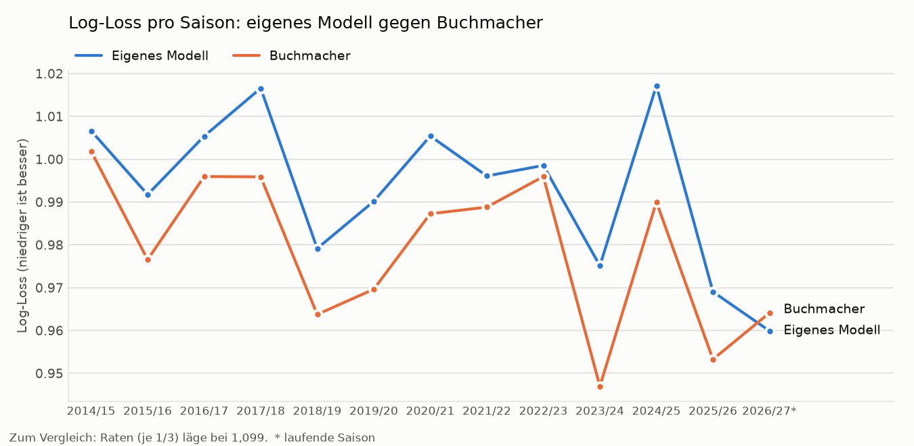

# Bundesliga Match Predictor

Predicts Bundesliga matches as full scoreline probabilities: home win / draw / away win,
expected goals, and the [Kicktipp](https://www.kicktipp.de) tip with the most expected points.
Built from Elo ratings, a Dixon-Coles goal model and bookmaker odds, and evaluated with a
strict walk-forward backtest over 12+ seasons.

---

## Results

Walk-forward backtest 2014/15 – 2026/27 (3,762 matches). Every matchday was predicted only
with data that was available before kickoff.

| Model | Log loss ↓ | RPS ↓ | Accuracy | Kicktipp pts / match |
|---|---|---|---|---|
| Base rates (historical H/D/A mix) | 1.069 | 0.230 | 44.6 % | 1.17 |
| Elo | 0.997 | 0.205 | 51.1 % | 1.31 |
| Dixon-Coles | 0.996 | 0.204 | 51.5 % | 1.32 |
| **Own ensemble (Elo + Dixon-Coles)** | **0.995** | **0.204** | **51.4 %** | **1.31** |
| Bookmakers (average odds) | 0.980 | 0.200 | 52.6 % | 1.34 |
| Ensemble + odds | 0.980 | 0.200 | 52.5 % | 1.34 |

Guessing 1/3 for every outcome gives a log loss of 1.099.

- The own model beats "always predict a home win" (44.6 %) by about 7 points and is well
  calibrated: when it says 40 %, it happens about 40 % of the time.
- It does **not** beat the bookmakers. When the ensemble may also use the odds, it learns a
  weight of 100 % for the market: the odds already contain everything Elo and Dixon-Coles
  know. That is the expected outcome with public data, and the tool uses the odds whenever
  they are available.
- Kicktipp (standard 4/3/2 scoring): about 400 points per season with the own model,
  about 408 with odds.



Full numbers per season, Kicktipp points and a calibration plot: [reports/backtest.md](reports/backtest.md).

### Compared to version 1

Version 1 (XGBoost + SMOTE on 42 hand-made features) was re-evaluated on 2024/25:
**41.5 % accuracy and a log loss of 1.101, slightly worse than guessing.** The ~48 % it
reported came from evaluation bugs: swapped class names in the classification report,
every test match counted twice, and a draw threshold tuned on the test data.
Version 2 on the same season: 51.6 % / 1.017 (own model) and 52.0 % / 0.990 (with odds).

---

## How it works

Every model produces a **scoreline matrix** per match, `P(home scores i, away scores j)`.
Home/draw/away probabilities, expected goals and the Kicktipp tip all follow from it.

1. **Data.** Results and average odds from football-data.co.uk since 2005/06 (6,500+ matches),
   fixtures from OpenLigaDB, odds for upcoming matches from football-data's fixtures file.
   Team names from both sources are mapped to one spelling; an unknown name stops the run
   instead of silently dropping a match.
2. **Elo.** One rating per club that carries across seasons. Big wins count more, ratings move
   a third of the way back to the league mean each summer, and promoted clubs inherit the
   average rating of the clubs they replace. A Poisson regression turns the rating gap into
   expected goals.
3. **Dixon-Coles.** Attack and defence strength per club, home advantage and a correction for
   low scores (0:0, 1:1). Fitted by maximum likelihood with exponentially decaying weights
   (half-life 270 days), ridge shrinkage, and a prior that pulls promoted clubs towards the
   relegated clubs' strength.
4. **Market.** Bookmaker margin removed, then the expected goals that reproduce the
   1X2 and over/under 2.5 probabilities are solved for, giving a full scoreline matrix.
5. **Ensemble.** A weighted mix of the scoreline matrices. Weights are learned by minimising
   log loss on earlier seasons' out-of-sample predictions.
6. **Kicktipp tip.** For every candidate tip, the expected points over the whole scoreline
   matrix. The most likely scoreline is often not the best tip; a draw almost never is.

### Methodology

- **Walk-forward:** models are refitted before every block of matchdays (Fri–Sun or midweek)
  using only earlier matches.
- **No tuning on test data:** hyperparameters were chosen by grid search on 2008/09–2013/14
  ([models/hyperparams.json](models/hyperparams.json)); results are reported from 2014/15 on.
  Ensemble weights for a season are learned only from earlier seasons.
- **Proper scoring rules:** log loss and RPS judge the probabilities themselves, not just
  whether the favourite won.

---

## Usage

```bash
python3 -m venv .venv
source .venv/bin/activate
pip install -r requirements.txt
```

```bash
python -m bundesliga predict                  # current matchday
python -m bundesliga predict --spieltag 12    # a specific matchday
python -m bundesliga predict --modell own     # own model only, ignore odds
python -m bundesliga backtest                 # rerun the backtest, writes reports/
python -m bundesliga tune                     # re-tune hyperparameters (about 45 s)
python -m bundesliga update                   # only refresh the data
pytest                                        # 45 tests, no network needed
```

Example (matchday 11, 2026/27, before odds were published). The CLI output is in German:

```
Bundesliga 2026/27, 11. Spieltag

         Anstoß          Heim          Gast    1    X    2      xG Tipp  erw. Punkte  Basis
Fr 27.11. 20:30 Werder Bremen    M'gladbach 54 % 24 % 22 % 1.9:1.1  2:1         1.40 Modell
Sa 28.11. 15:30       Hamburg Bayern Munich  9 % 15 % 76 % 0.9:2.8  0:2         1.82 Modell
Sa 28.11. 15:30       FC Koln    Elversberg 43 % 26 % 30 % 1.6:1.3  2:1         1.17 Modell
So 29.11. 15:30      Freiburg    RB Leipzig 36 % 25 % 39 % 1.5:1.6  1:2         1.06 Modell
So 29.11. 19:30      Dortmund    Leverkusen 53 % 24 % 23 % 1.9:1.2  2:1         1.38 Modell
...
```

football-data.co.uk usually publishes odds for the upcoming matchday on Tuesdays and Fridays.
Until then the tool falls back to the own model and says so; run it again later for the
odds-based version. Predictions are saved to `predictions/`.

---

## Project structure

```
bundesliga-predictor/
├── bundesliga/
│   ├── __main__.py        # command line: update, tune, backtest, predict
│   ├── data.py            # download and normalise results + odds
│   ├── fixtures.py        # OpenLigaDB fixtures, upcoming odds
│   ├── teams.py           # one spelling per club
│   ├── scores.py          # scoreline matrices, odds -> expected goals
│   ├── kicktipp.py        # points and the best tip
│   ├── metrics.py         # log loss, RPS, Brier, accuracy
│   ├── models/
│   │   ├── elo.py
│   │   ├── dixon_coles.py
│   │   ├── market.py
│   │   └── ensemble.py
│   ├── backtest.py        # walk-forward backtest and tuning
│   ├── predict.py         # matchday prediction
│   └── report.py          # reports/backtest.md and charts
├── models/                # tuned hyperparameters and ensemble weights (JSON)
├── reports/               # backtest report and charts
└── tests/
```

---

## Limitations

- No line-ups, injuries or expected-goals (xG) data.
- The odds are averages collected one to two days before kickoff; closing odds would be sharper.
- Kicktipp uses the default rules (4 exact / 3 goal difference / 2 tendency, no goal-difference
  points for draws). Other rules can be set in `bundesliga/kicktipp.py`.

## Data sources

- Results and odds: [football-data.co.uk](https://www.football-data.co.uk/germany.php)
- Fixtures: [OpenLigaDB](https://www.openligadb.de)

## Author

**David**
[GitHub](https://github.com/DavidStaufer) · [LinkedIn](https://linkedin.com/in/DavidStaufer)
