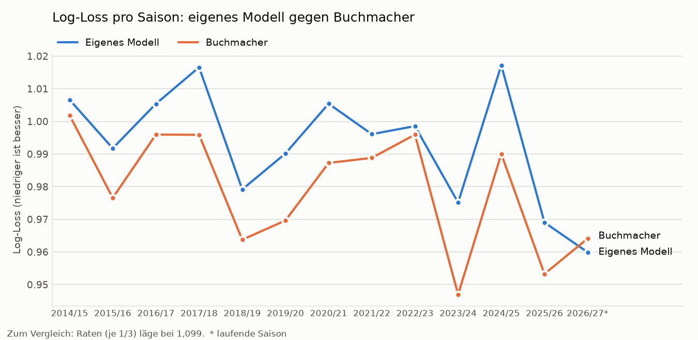
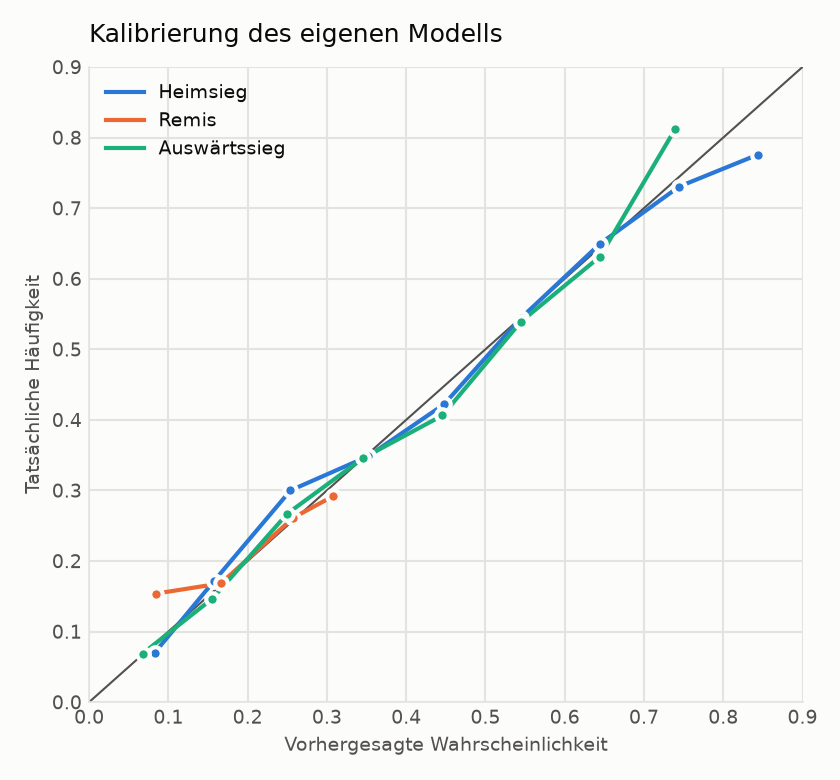

# Backtest-Bericht

Testzeitraum 2014/15 bis 2026/27, 3762 Spiele.
Jeder Spieltag wurde nur mit Daten vorhergesagt, die vorher bekannt waren.

## Gesamt

| Modell | Log-Loss | RPS | Brier | Trefferquote | Kicktipp-Punkte/Spiel |
|---|---|---|---|---|---|
| Häufigkeit (Basis) | 1.0685 | 0.2299 | 0.6461 | 0.4460 | 1.1656 |
| Elo | 0.9965 | 0.2049 | 0.5948 | 0.5114 | 1.3094 |
| Dixon-Coles | 0.9960 | 0.2043 | 0.5943 | 0.5154 | 1.3155 |
| Eigenes Ensemble (Elo + DC) | 0.9951 | 0.2043 | 0.5938 | 0.5136 | 1.3107 |
| Buchmacher | 0.9801 | 0.1995 | 0.5834 | 0.5258 | 1.3413 |
| Ensemble + Quoten | 0.9802 | 0.1996 | 0.5835 | 0.5253 | 1.3400 |

Log-Loss, RPS und Brier: niedriger ist besser. Raten (je 1/3) hätte einen Log-Loss von 1.0986.

## Log-Loss pro Saison

| Saison | Häufigkeit (Basis) | Elo | Dixon-Coles | Eigenes Ensemble (Elo + DC) | Buchmacher | Ensemble + Quoten | Spiele |
|---|---|---|---|---|---|---|---|
| 2014/15 | 1.061 | 1.006 | 1.009 | 1.007 | 1.002 | 1.001 | 306.000 |
| 2015/16 | 1.068 | 0.995 | 0.991 | 0.992 | 0.977 | 0.977 | 306.000 |
| 2016/17 | 1.049 | 1.010 | 1.003 | 1.005 | 0.996 | 0.996 | 306.000 |
| 2017/18 | 1.069 | 1.018 | 1.018 | 1.017 | 0.996 | 0.997 | 306.000 |
| 2018/19 | 1.065 | 0.974 | 0.985 | 0.979 | 0.964 | 0.964 | 306.000 |
| 2019/20 | 1.083 | 0.993 | 0.989 | 0.990 | 0.970 | 0.970 | 306.000 |
| 2020/21 | 1.081 | 1.012 | 1.003 | 1.005 | 0.987 | 0.987 | 306.000 |
| 2021/22 | 1.058 | 0.997 | 0.998 | 0.996 | 0.989 | 0.989 | 306.000 |
| 2022/23 | 1.057 | 0.998 | 1.002 | 0.999 | 0.996 | 0.996 | 306.000 |
| 2023/24 | 1.075 | 0.978 | 0.975 | 0.975 | 0.947 | 0.947 | 306.000 |
| 2024/25 | 1.094 | 1.020 | 1.017 | 1.017 | 0.990 | 0.990 | 306.000 |
| 2025/26 | 1.071 | 0.970 | 0.971 | 0.969 | 0.953 | 0.953 | 306.000 |
| 2026/27 | 1.040 | 0.956 | 0.966 | 0.960 | 0.964 | 0.964 | 90.000 |

## Kicktipp-Punkte pro Saison (4/3/2, bester Tipp pro Spiel)

| Saison | Häufigkeit (Basis) | Elo | Dixon-Coles | Eigenes Ensemble (Elo + DC) | Buchmacher | Ensemble + Quoten | Spiele |
|---|---|---|---|---|---|---|---|
| 2014/15 | 384 | 403 | 410 | 396 | 424 | 418 | 306 |
| 2015/16 | 359 | 406 | 401 | 402 | 416 | 418 | 306 |
| 2016/17 | 411 | 388 | 379 | 381 | 411 | 409 | 306 |
| 2017/18 | 366 | 373 | 393 | 382 | 407 | 408 | 306 |
| 2018/19 | 348 | 404 | 407 | 409 | 401 | 401 | 306 |
| 2019/20 | 322 | 413 | 428 | 420 | 405 | 405 | 306 |
| 2020/21 | 344 | 385 | 382 | 370 | 393 | 393 | 306 |
| 2021/22 | 379 | 382 | 385 | 388 | 389 | 389 | 306 |
| 2022/23 | 368 | 405 | 408 | 409 | 404 | 404 | 306 |
| 2023/24 | 338 | 403 | 399 | 407 | 419 | 419 | 306 |
| 2024/25 | 299 | 394 | 395 | 399 | 412 | 412 | 306 |
| 2025/26 | 352 | 432 | 429 | 424 | 424 | 424 | 306 |
| 2026/27 | 115 | 138 | 133 | 144 | 141 | 141 | 90 |

## Kalibrierung

## Ensemble-Gewichte für Live-Vorhersagen

{'own': {'elo': 0.4611, 'dc': 0.5389}, 'combined': {'elo': 0.0, 'dc': 0.0, 'market': 1.0}}
